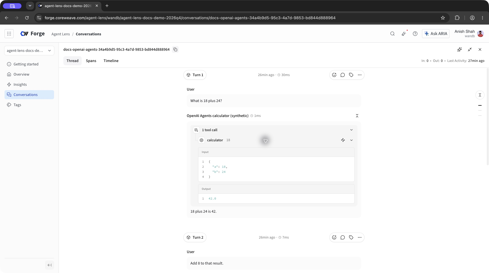

# **Weave by Weights & Biases**

[](http://wandb.me/weave_colab)
[](https://pypi.org/project/weave)
[](https://pypistats.org/packages/weave)
[](https://github.com/wandb/weave)

Weave is a toolkit for tracing and evaluating AI agents, built by [Weights & Biases](https://wandb.ai/).

You can use Weave to:

- **Trace agents.** Inspect conversations, turns, LLM calls, and tool calls in **CoreWeave Agent Lens**.
- **Evaluate** agents and LLM applications.
- **Trace functions** with `@weave.op` for the Weave **Calls** workflow.

## Documentation

Start here for agents:

- [Choose an Agent Lens integration](https://docs.coreweave.com/products/agent-lens/get-started/integrations?utm_source=github&utm_medium=referral&utm_campaign=agent-lens-integrations-2026q4&utm_content=weave-readme-agent-quickstart) — choose the guide for your provider SDK, agent SDK, or harness. Each guide specifies the required package and conversation grouping.
- [Custom agents](https://docs.coreweave.com/products/agent-lens/get-started/custom-agents) — instrument a multi-turn agent with the Forge SDK. Existing Weave Conversation SDK instrumentation can also send agent spans to Agent Lens.

## Prerequisites

- Python 3.10 or higher
- A [CoreWeave Forge account](https://forge.coreweave.com) with access to the destination project
- A Forge API key from [API key settings](https://forge.coreweave.com/settings#apikeys). Set `WANDB_API_KEY`.
- An [OpenAI API key](https://platform.openai.com/api-keys) in `OPENAI_API_KEY`, for the example below.

## Quick start: trace an agent

This example uses the [OpenAI Agents SDK](https://docs.coreweave.com/products/agent-lens/integrations/openai-agents-sdk). The Python import is `agents`; the package name is `openai-agents`. Weave autopatches it after `weave.init()`. The resulting turns appear in Agent Lens **Conversations**.

```bash
pip install weave openai-agents requests
```

```python
import asyncio
import uuid
import requests
import weave
from agents import Agent, RunConfig, Runner, function_tool

weave.init("<your-team>/<your-project-name>")


@function_tool
def wikipedia_search(query: str) -> str:
    """Search Wikipedia for a topic and return its title and intro paragraph."""
    r = requests.get(
        "https://en.wikipedia.org/w/api.php",
        params={
            "action": "query",
            "generator": "search",
            "gsrsearch": query,
            "gsrlimit": 1,
            "prop": "extracts",
            "exintro": True,
            "explaintext": True,
            "format": "json",
        },
        headers={"User-Agent": "weave-demo"},
    ).json()
    page = next(iter(r["query"]["pages"].values()))
    return f"{page['title']}: {page['extract']}"


agent = Agent(
    name="Research assistant",
    instructions=(
        "You are a research assistant. Use the wikipedia_search tool to look up "
        "topics when needed, and cite the article titles you used."
    ),
    tools=[wikipedia_search],
)


async def main():
    run_config = RunConfig(group_id=str(uuid.uuid4()))
    history = []
    for question in [
        "Who founded Anthropic?",
        "What is Claude (the AI assistant)?",
        "Summarize what we discussed in one sentence.",
    ]:
        history.append({"role": "user", "content": question})
        print(f"USER: {question}")
        result = await Runner.run(agent, input=history, run_config=run_config)
        print(f"AGENT: {result.final_output}\n")
        history = result.to_input_list()


asyncio.run(main())
weave.finish()
```

Open `https://forge.coreweave.com/agent-lens/<your-team>/<your-project-name>` and select **Conversations**. The shared `group_id` groups all three turns into one conversation; `history` carries context between turns.



This October 22, 2026 capture uses a synthetic calculator example with OpenAI Agents SDK 0.24.0 and Weave 0.53.12. Model responses are fixtures; tool execution and Agent Lens export are real. It illustrates the conversation view, not the Wikipedia example's output.

For Claude Agent SDK, resume the same session on later turns. For Google ADK, import `google.adk` before `weave.init()` and reuse the ADK session ID. Follow the [matching integration guide](https://docs.coreweave.com/products/agent-lens/get-started/integrations) for setup and grouping.

## Custom agents

The Weave Conversation SDK can wrap your own agent loop. For a new integration, start with the [Forge SDK custom-agent quickstart](https://docs.coreweave.com/products/agent-lens/get-started/custom-agents). The following Weave example remains supported.

Use `start_conversation`, `start_turn`, and `start_llm`. In Python they are context managers and close on exceptions. `start_session` and `Session` still exist; they emit a `DeprecationWarning`. Do not use them in new code.

```python
import weave

weave.init("<your-team>/<your-project-name>")

with weave.start_conversation(agent_name="research-bot"):
    with weave.start_turn(user_message="Who founded Anthropic?"):
        with weave.start_llm(model="gpt-4o-mini", provider_name="openai") as llm:
            llm.output("Anthropic was founded by former OpenAI researchers.")
            llm.record(
                usage=weave.Usage(input_tokens=12, output_tokens=9),
                response_model="gpt-4o-mini",
            )
```

Always pass `provider_name`. Weave does not infer it from the model name.

For a multi-turn loop with tools, see the [custom agents quickstart](https://docs.coreweave.com/products/agent-lens/get-started/custom-agents).

## Function tracing

`@weave.op` traces a function. Those traces land in the Weave **Calls** tab. Use it for evaluations, scorers, and LLM calls that are not an agent loop.

Plain `openai` is also auto-traced into the Calls tab after `weave.init()`. `@weave.op` wraps the call in a parent function, so the OpenAI request sits under `extract_fruit`.

```bash
pip install weave openai
```

```python
import json
import weave
from openai import OpenAI

weave.init("<your-team>/<your-project-name>")


@weave.op
def extract_fruit(sentence: str) -> dict:
    client = OpenAI()
    response = client.chat.completions.create(
        model="gpt-4o-mini",
        messages=[
            {
                "role": "system",
                "content": (
                    "You will be provided with unstructured data, and your task is to parse "
                    "it into one JSON object with fruit, color and flavor as keys."
                ),
            },
            {"role": "user", "content": sentence},
        ],
        temperature=0.7,
        response_format={"type": "json_object"},
    )
    extracted = response.choices[0].message.content
    return json.loads(extracted)


extract_fruit(
    "There are many fruits that were found on the recently discovered planet Goocrux. "
    "There are neoskizzles that grow there, which are purple and taste like candy."
)
```

## Contributing

Interested in pulling back the hood or contributing? Awesome, before you dive in, here's what you need to know.

We're in the process of 🧹 cleaning up 🧹. This codebase contains a large amount code for the "Weave engine" and "Weave boards", which we've put on pause as we focus on Tracing and Evaluations.

The Weave Tracing code is mostly in `weave/trace`. The trace server it talks to is developed in wandb/core.

The Weave Evaluations code is mostly in `weave/flow`.
